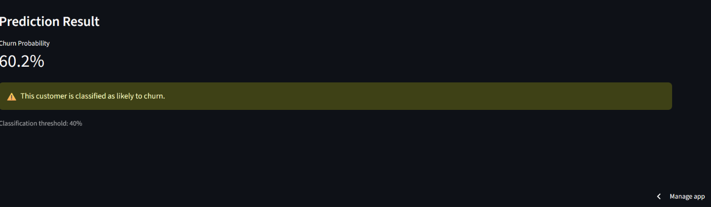

# 📊 Prédiction de l'Attrition des Clients — Customer Churn Prediction

## 📌 Présentation du projet

Ce projet de Machine Learning vise à prédire les clients susceptibles de résilier leur abonnement auprès d'un opérateur de télécommunications.

À partir de données clients, le modèle identifie les facteurs associés au départ des clients et estime leur probabilité de résiliation. Une application interactive développée avec Streamlit permet de tester le modèle et de faciliter l'interprétation des prédictions.

**Objectif principal :** aider les entreprises à anticiper l'attrition des clients et à mettre en place des stratégies de fidélisation fondées sur les données.

## 🎯 Objectifs

- Analyser les caractéristiques des clients et les facteurs associés à la résiliation.
- Explorer et préparer les données avant la modélisation.
- Construire et comparer plusieurs modèles de Machine Learning.
- Évaluer les performances à l'aide de métriques adaptées.
- Ajuster le seuil de décision pour mieux détecter les clients susceptibles de partir.
- Développer une application interactive permettant d'effectuer des prédictions.

## 📂 Jeu de données

Le projet utilise le jeu de données **Telco Customer Churn**, disponible sur Kaggle.

- **Source :** [Telco Customer Churn — Kaggle](https://www.kaggle.com/datasets/blastchar/telco-customer-churn)
- **Nombre d'observations après nettoyage :** 7 032 clients.
- **Variable cible :** `Churn`
  - `Yes` : le client a résilié son abonnement.
  - `No` : le client n'a pas résilié son abonnement.

Les variables comprennent notamment :

- Les caractéristiques démographiques des clients.
- La durée de leur abonnement.
- Les services souscrits.
- Le type de contrat.
- Le mode de paiement.
- Les frais mensuels et les frais totaux.

## 🛠️ Technologies utilisées

- **Python** — programmation et analyse de données
- **Pandas et NumPy** — manipulation et préparation des données
- **Scikit-learn** — prétraitement et modélisation
- **Matplotlib et Seaborn** — visualisation des données
- **Streamlit** — développement du tableau de bord interactif
- **GitHub** — gestion et partage du code
- **Streamlit Community Cloud** — déploiement de l'application

## 🔎 Analyse exploratoire des données (EDA)

L'analyse exploratoire a permis de mettre en évidence plusieurs tendances :

- **Type de contrat :** le taux de résiliation est d'environ 42,71 % chez les clients ayant un contrat mensuel, contre 11,28 % pour les contrats d'un an et 2,85 % pour les contrats de deux ans.
- **Ancienneté :** les clients ayant résilié présentent une ancienneté moyenne d'environ 18 mois, contre 38 mois pour les clients restés.
- **Frais mensuels :** les clients ayant résilié paient en moyenne 74,44 $ par mois, contre 61,31 $ pour les autres clients.

Ces résultats suggèrent que la durée d'engagement, l'ancienneté et le niveau des frais mensuels sont des indicateurs importants à examiner dans une stratégie de fidélisation.

## 🤖 Modèles de Machine Learning

Deux modèles ont été entraînés et évalués :

1. **Régression logistique (Logistic Regression)**
2. **Forêt aléatoire (Random Forest)**

Les performances ont été mesurées à l'aide de l'accuracy, de la précision, du rappel, du F1-score et de l'aire sous la courbe ROC (ROC-AUC).

### 📈 Résultats des modèles

| Métrique | Régression logistique | Forêt aléatoire |
|---|---:|---:|
| Accuracy | 80,38 % | 77,54 % |
| Précision | 64,85 % | 57,04 % |
| Rappel | 57,22 % | 62,83 % |
| F1-score | 60,80 % | 59,80 % |
| ROC-AUC | 83,59 % | 82,50 % |

La régression logistique obtient la meilleure accuracy et le meilleur F1-score au seuil de décision initial de 0,50. La forêt aléatoire présente toutefois un rappel plus élevé.

## ⚙️ Optimisation du seuil de décision

Le seuil de décision de la régression logistique a été ajusté de 0,50 à **0,40** afin d'améliorer la détection des clients susceptibles de résilier.

| Métrique | Seuil de 0,50 | Seuil de 0,40 |
|---|---:|---:|
| Accuracy | 80,38 % | 78,39 % |
| Précision | 64,85 % | 57,92 % |
| Rappel | 57,22 % | 68,45 % |
| F1-score | 60,80 % | 62,75 % |

La diminution du seuil augmente le rappel : le modèle détecte ainsi une proportion plus importante des clients qui résilient, au prix d'une hausse des fausses alertes.

Ce compromis peut être intéressant pour une entreprise qui souhaite privilégier l'identification précoce des clients à risque.

## 🖥️ Application interactive

L'application Streamlit permet de saisir les caractéristiques d'un client et d'obtenir une prédiction de résiliation accompagnée d'une probabilité estimée.

**Accéder à l'application :** [Customer Churn Prediction — Streamlit](ADD_YOUR_STREAMLIT_APP_URL_HERE)

### Aperçu du tableau de bord



*Remarque : le fichier `churn_dashboard.png` doit être présent dans le dépôt GitHub pour que l'image s'affiche correctement.*

## 🚀 Exécution du projet en local

### 1. Cloner le dépôt

```bash
git clone https://github.com/lordleny-png/Customer-Churn-Prediction.git
cd Customer-Churn-Prediction
```

### 2. Installer les dépendances

```bash
pip install -r requirements.txt
```

### 3. Lancer l'application

```bash
streamlit run app.py
```

L'application s'ouvrira dans ton navigateur.

## 📁 Structure du projet

```text
Customer-Churn-Prediction/
│
├── app.py
├── churn_model_.json
├── requirements.txt
├── README.md
├── README_FR.md
└── churn_dashboard.png
```

## 💼 Valeur métier

La prédiction de l'attrition peut aider les opérateurs de télécommunications à :

- Identifier les clients présentant un risque élevé de résiliation.
- Prioriser les actions de fidélisation.
- Adapter les offres commerciales aux profils des clients.
- Mieux comprendre les facteurs associés au départ des clients.
- Soutenir la prise de décision grâce à l'analyse prédictive.

Le modèle constitue un outil d'aide à la décision. Ses prédictions doivent être interprétées avec discernement et évaluées régulièrement avant toute utilisation opérationnelle.

## ⚠️ Limites du projet

- Les performances dépendent de la qualité et de la représentativité des données.
- Les relations observées ne prouvent pas nécessairement un lien de causalité.
- Les faux positifs peuvent entraîner des actions de fidélisation inutiles.
- Le modèle doit être réévalué si les comportements des clients évoluent.
- Les résultats sont expérimentaux et ne garantissent pas les performances dans un contexte réel.

## 👤 Auteur

**Leny Napala**

Projet de Data Science et de Business Analytics consacré à la prédiction de l'attrition des clients.

